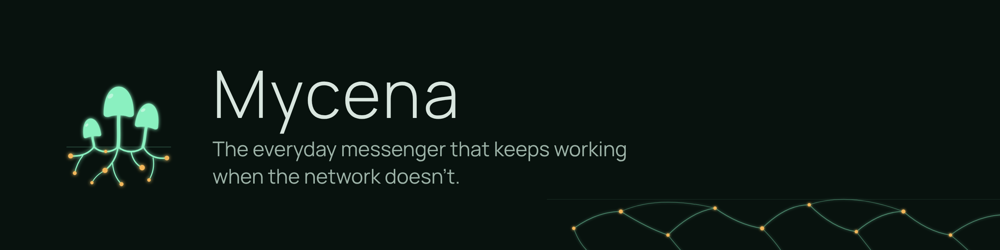

<p align="center">
  
</p>

<p align="center">
  <a href="LICENSE"></a>
  
  
</p>

# Mycena

**Mycena is an open-source messenger that keeps working when the network doesn't.**
Phones and laptops connect directly over Bluetooth and Wi-Fi and pass end-to-end encrypted
messages from device to device, with no central server, no account and no phone number.

Like the glowing mycelium beneath a forest, the network is invisible until you need it:
during a power cut, a storm, an overloaded network at a big event, or an internet shutdown.

## Why an everyday app

A mesh network only helps in a crisis if enough people around you already have the app.
That is why Mycena is built to be useful **every day**: chat with friends and neighbours,
share a local bulletin board, coordinate a club or a street. When mobile data and the internet
disappear, the same app quietly switches to the phones nearby and carries on.

## What works today

| | Status |
|---|---|
| End-to-end encrypted chat and groups | Working (beta) |
| Automatic connection on the same Wi-Fi (mDNS) | Working |
| Direct Bluetooth Low Energy links between Android phones | Working, validated on Pixel 6 |
| Direct Wi-Fi links (Wi-Fi Aware / Wi-Fi Direct) | Experimental prototype |
| Store-and-forward core for delayed delivery | Core in place |
| Crisis mode: help requests and resource pins get priority | Core in place |
| Optional internet relay for finding peers across networks | Working |
| Sandboxed mini-apps (MeshAid, local market, proximity) | Preview |
| Android app · desktop app (macOS, Linux) · iOS | Beta · experimental · groundwork |

**Next:** reliable delivery across many hops without a continuous connection, direct Wi-Fi
links (Wi-Fi Aware / Wi-Fi Direct) next to Bluetooth, a one-switch disaster profile, and field
tests with 10–50 devices from different manufacturers. See the [roadmap](docs/ROADMAP.md).

## Honest limits

Mycena is a **public technical beta**. It is not a replacement for emergency services, not a
security-audited tool, and not suitable against targeted surveillance or in hostile
environments. Hardware testing so far covers one device type. Call your local emergency number
when life or property is at risk.

| Scenario | Honest fit ([assessment](docs/BETA_SECURITY_ASSESSMENT.md)) |
|----------|-------------------------------------------------------------|
| LAN / internet outage among trained neighbours | **Limited** |
| Disaster or censorship via the default internet relay | **Limited** / **No** |
| Hostile country or targeted surveillance | **No** |

Details: [docs/KNOWN_LIMITATIONS.md](docs/KNOWN_LIMITATIONS.md) ·
[docs/HARDWARE_TEST_MATRIX.md](docs/HARDWARE_TEST_MATRIX.md) ·
[docs/THREAT_MODEL.md](docs/THREAT_MODEL.md).

MeshCoin (MXC) is an **experimental research preview** of offline credits for small local
exchanges. It is not money, not an investment and not a cryptocurrency; see
[docs/MESHCOIN_POSITIONING.md](docs/MESHCOIN_POSITIONING.md).

## Project

- **Repositories:** this app · [mycena-relay](https://github.com/mycena-project/mycena-relay) (optional bootstrap relay)
- **Maintainer:** Alex — an independent, non-commercial open-source project
- **Contributing:** [CONTRIBUTING.md](CONTRIBUTING.md) · **Security:** [SECURITY.md](SECURITY.md)
- **Documentation overview:** [docs/README.md](docs/README.md) · **Governance:** [GOVERNANCE.md](GOVERNANCE.md) · **Contributor agreement:** [CLA.md](CLA.md)

## Requirements

### Android (primary beta target)

| Requirement | Detail |
|-------------|--------|
| **OS** | Android 8.0 (API 26) or newer (intended floor; tested so far on Android 17, Pixel 6) |
| **Network** | Wi‑Fi and/or mobile data for optional relay bootstrap; the LAN mesh works without internet |
| **Permissions** | Internet, notifications, optional camera (QR), location (BLE bootstrap, opt-in), Bluetooth (nearby discovery, opt-in) |

See [android/README.md](android/README.md) for build instructions.

**Future iOS:** native Swift shell over the same UniFFI contract — groundwork only; see [docs/MOBILE_PLATFORMS.md](docs/MOBILE_PLATFORMS.md) and [ios/README.md](ios/README.md).

### Desktop (Tauri)

macOS or Linux with Rust toolchain. Experimental — same Rust mesh stack, linked **natively** in Tauri (not UniFFI). See [docs/MOBILE_PLATFORMS.md](docs/MOBILE_PLATFORMS.md) for Android vs desktop vs future iOS hosts.

## Try it

**Android:** download the APK from the latest [release](https://github.com/mycena-project/Mycena/releases) and install it
(`adb install -r mycena-*.apk`, or open the file on the phone). It is a debug-signed technical preview for trying the app;
it is not on Google Play yet.

| Artifact | How to build | Signing | Use |
|----------|--------------|---------|-----|
| **Development APK** | `make android-apk` (disk-guarded, see [docs/ANDROID_BUILD.md](docs/ANDROID_BUILD.md)) | Android debug key | Trying the app, development |
| **Technical Beta APK** | `./scripts/build-technical-beta-apk.sh` | Local Technical Beta keystore | Phone-to-phone sharing of the app |

Phone-to-phone sharing of the app itself needs the Technical Beta signing key, so it refuses a debug install.
Details: [docs/TECHNICAL_BETA_ARTIFACT.md](docs/TECHNICAL_BETA_ARTIFACT.md).

**Desktop (experimental):** build locally with `cargo tauri build -p mycena-desktop`.

> **License (AGPL-3.0-or-later):** Mycena is free software. If you modify and run it (or a [bootstrap relay](https://github.com/mycena-project/mycena-relay)) as a **network service**, you must offer corresponding source to users. See [LICENSE](LICENSE) and [RELEASING.md](RELEASING.md).

**CLI (developers):**

```bash
# Interactive node + HTTP API on :7760 (loopback, bearer token printed at start)
cargo run -p mycena-cli -- --api-port 7760

# Headless server (API only, no stdin)
cargo run -p mycena-cli -- --headless --api-port 7760

# Groups / panic wipe (offline). Wallet is experimental preview — not money.
cargo run -p mycena-cli -- group create "Neighborhood"
cargo run -p mycena-cli -- panic --yes --db .mycena-node
```

Start two terminals on the same LAN, exchange peer IDs, then `/chat <peer_id> hello` or `/broadcast mycena/chat hello`.

## Architecture (short)

```text
┌─────────────┐   Noise + Ed25519    ┌─────────────┐
│   Mycena    │◄──── libp2p ────────►│   Mycena    │
│    node     │   gossip / direct    │    node     │
└──────┬──────┘                      └──────┬──────┘
       │         store-and-forward          │
       │      (sled, TTL, hop limits)       │
       ▼                                    ▼
┌──────────────────────────────────────────────────┐
│ Mesh: mDNS (LAN) · Bluetooth LE · Wi-Fi Direct   │
│ (experimental) · QR invites · optional relay     │
│ Bootstrap: mycena-relay.fly.dev (optional)       │
└──────────────────────────────────────────────────┘
       │
       ▼
┌──────────────────────────────────────────────────┐
│ Crypto: X25519 + ChaCha20-Poly1305 (E2E chat)    │
│ Ed25519 message auth · groups use a shared key   │
│ Keys at rest: Android Keystore / OS keyring      │
└──────────────────────────────────────────────────┘
```

- **Mesh layer** — libp2p with scoped gossip, bloom anti-entropy, reputation, and bounded relay fanout. Bluetooth is opt-in and so far validated on one device type ([KNOWN_LIMITATIONS.md](docs/KNOWN_LIMITATIONS.md)). See [docs/network-hardening.md](docs/network-hardening.md) and [docs/DISCOVERY.md](docs/DISCOVERY.md).
- **Crypto** — direct messages encrypted when keys are known; signatures on envelopes. Partial forward secrecy via v1 Double Ratchet for 1:1 after prekey exchange; v0/groups remain static-key. See [docs/SECURITY.md](docs/SECURITY.md).
- **Store-and-forward** — messages persist locally (sled) with TTL and priority; nodes relay for peers when paths exist.

Deeper design: [docs/architecture.md](docs/architecture.md) · [docs/CONNECT.md](docs/CONNECT.md)

## Contributing

The stabilisation phase of the beta (August to November 2026) is complete; work now follows the
[roadmap](docs/ROADMAP.md). Bug reports, device test results, translations and documentation fixes are
especially welcome. See [CONTRIBUTING.md](CONTRIBUTING.md).

**Security:** report vulnerabilities to **github.com/mycena-project/Mycena/security/advisories/new** — not via public issues. See [SECURITY.md](SECURITY.md).

## License

Copyright (C) 2026 Alexander Senf and Mycena contributors.

Licensed under [GNU Affero General Public License v3.0 or later](LICENSE) (AGPL-3.0-or-later). Network users interacting with modified versions over a network may request corresponding source per the license.

## More documentation

| Topic | Doc |
|-------|-----|
| User-facing security | [docs/security-for-users.md](docs/security-for-users.md) |
| Known limitations | [docs/KNOWN_LIMITATIONS.md](docs/KNOWN_LIMITATIONS.md) |
| Roadmap | [docs/ROADMAP.md](docs/ROADMAP.md) |
| Threat model | [docs/THREAT_MODEL.md](docs/THREAT_MODEL.md) |
| Store-and-forward design | [docs/CUSTODY_DTN.md](docs/CUSTODY_DTN.md) |
| Hardware tested so far | [docs/HARDWARE_TEST_MATRIX.md](docs/HARDWARE_TEST_MATRIX.md) |
| Open security debt | [docs/SECURITY_DEBT_REGISTER.md](docs/SECURITY_DEBT_REGISTER.md) |
| Everything else | [docs/README.md](docs/README.md) |

## CI

Rust: [`.github/workflows/ci.yml`](.github/workflows/ci.yml) · Android: [`.github/workflows/android-ci.yml`](.github/workflows/android-ci.yml) · **Release (tag `v*.*.*`):** [`.github/workflows/release.yml`](.github/workflows/release.yml) — APK + desktop + SHA256SUMS. See [RELEASING.md](RELEASING.md).

Rust tests without a local toolchain: `docker compose --profile rust run --rm rust-tests` ([docker-compose.yml](docker-compose.yml)).
