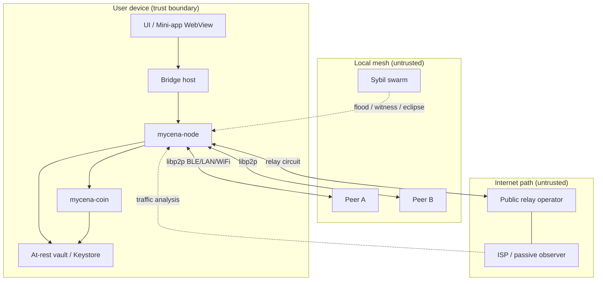

# Mycena — Threat Model

**Status:** Pre–public release · **required input for external security review**
**Version:** 1.1 · July 2026
**Audience:** Security reviewers, engineering, product, legal
**Tone:** Hostile networks, malicious peers, compromised devices, selective nation-state interest.

This document is the **adversary and asset model** that unifies existing security work. It does **not** replace detailed debt tracking or privacy planning — it links them.

**Scope boundary:** [§2 Out of scope and explicit design goals](#2-out-of-scope-and-explicit-design-goals) states what Mycena deliberately does **not** promise (e.g. nation-state targeting of an individual). Read it before comparing the project to Tor, whistleblower tools, or forensic-resistance products.

| Document | Role |
|----------|------|
| [SECURITY_DEBT_REGISTER.md](./SECURITY_DEBT_REGISTER.md) | Canonical open mitigations (`SD-*`) |
| [PRIVACY_ROADMAP.md](./PRIVACY_ROADMAP.md) | Privacy phases A–D and data-minimization plan |
| [SECURITY_ASSUMPTIONS.md](./SECURITY_ASSUMPTIONS.md) | User-facing trust assumptions |
| [PLAY_CONSOLE_DATA_SAFETY.md](./PLAY_CONSOLE_DATA_SAFETY.md) | Play Store Data Safety form fill-in guide |
| [PRE_RELEASE_GAPS.md](./PRE_RELEASE_GAPS.md) | Do-now vs document vs external before Play beta |
| [BETA_SECURITY_ASSESSMENT.md](./BETA_SECURITY_ASSESSMENT.md) | Scenario verdicts (protest, hostile country, …) |
| [KNOWN_LIMITATIONS.md](./KNOWN_LIMITATIONS.md) | Explicit non-goals |
| [VOUCHER_SETTLEMENT.md](./VOUCHER_SETTLEMENT.md) · [CUSTODY_DTN.md](./CUSTODY_DTN.md) | Asset-specific protocol detail |

**Maintenance:** Update this file when a new `SD-*` row is added or when an adversary profile materially changes. Do not duplicate full debt entries here — link by ID.

---

## 1. Methodology

We use a **STRIDE-inspired** model adapted for decentralized mesh + optional Internet relay:

| STRIDE | Mesh interpretation |
|--------|---------------------|
| **S**poofing | Fake PeerId, author, witness, voucher issuer, relay identity |
| **T**ampering | Modify gossip, custody envelopes, ledger events, mini-app bundles |
| **R**epudiation | Deny sending bulletin / voucher / custody handoff (limited — local logs only) |
| **I**nformation disclosure | Metadata leakage, E2E break, vault exfil, relay IP logging |
| **D**enial of service | Spam, amplification, custody fill, relay drop, battery drain |
| **E**levation of privilege | Bridge escape, root bypass, Sybil witness quorum, unsigned wire downgrade |

Each threat below references **Security Debt IDs** (`SD-*`) and, where applicable, **Privacy Roadmap phases** (A–D from [PRIVACY_ROADMAP.md](./PRIVACY_ROADMAP.md)).

---

## 2. Out of scope and explicit design goals

This section is **public by design**. It defines the boundary of what Mycena is built for so reviewers, users, and critics can judge the project against its **stated intent** — not against every conceivable adversary.

### 2.1 Not in scope — do not expect these protections

Mycena is **not** designed to protect a **specific targeted individual** against a **resource-rich state-level adversary** that can combine long-term surveillance, legal compulsion, infrastructure control, and targeted operations. **This is not a whistleblower tool** and must not be marketed or evaluated as one.

The following are **explicitly out of scope** (non-goals, not “future phases we forgot to ship”):

| Out of scope | Meaning for users and reviewers |
|--------------|----------------------------------|
| **Tor-class traffic-analysis resistance** | Default paths leak timing, volume, and interest patterns to peers, LAN observers, and relay operators. We do not claim metadata anonymity comparable to Tor or mix networks on stock settings. |
| **Duress / coercion unlock on mobile** | No decoy PIN, panic unlock that presents a benign vault, or cryptographic proof that the user acted under coercion. Device unlock is the OS boundary. |
| **Forensic device-seizure resistance** | Seized, unlocked, or rooted devices may yield keys, history, and cached state. Panic wipe clears **local** state only; mesh copies elsewhere may persist until TTL (see [§6.7](#67-mesh-copies-are-not-erasable-centrally)). |
| **Attacker with physical access to the target device** | Shoulder surfing, unlocked-phone use, adb/debugging, chip-off storage, or coercion at the keyboard are outside the threat model we optimize for. |

If your threat model requires any row above, use additional tools (Tor, dedicated secure messengers with documented nation-state posture, hardware tokens, operational security) — **not Mycena alone**.

### 2.2 In scope — what we treat as design goals

These are **first-class objectives**; engineering and security debt work (`SD-*`) are prioritized against them:

| In scope | Design intent |
|----------|----------------|
| **Core function during complete Internet outage** | Mesh relay, custody DTN, SOS/resource-map scopes, and crisis-mode prioritization remain usable when upstream connectivity is gone. |
| **No single organization or jurisdiction can shut down the entire network** | Decentralized peers, multi-relay bootstrap, and local mesh paths — no one operator is a global kill switch. |
| **Everyday security against common threats** | Data loss, crashes, known software vulnerabilities (tracked in [SECURITY_DEBT_REGISTER.md](./SECURITY_DEBT_REGISTER.md)), coarse abuse (spam, Sybil floods, SOS/custody stuffing), and honest-user mistakes — mitigated with rate limits, reputation gating, E2E where enabled, and fail-closed defaults. |

Nation-state **mass** surveillance and **local** Sybil/eclipse attacks **are** considered where they affect mesh **availability** for ordinary users (see [§5.4 Sybil swarm](#54-sybil-swarm-in-local-mesh), SOS crisis gating). That is **not** the same as protecting one high-value individual from a **focused** state campaign.

### 2.3 How to use this section

- **Product and store copy** must not imply whistleblower-grade or Tor-grade anonymity.
- **Security reviews** should map findings to §2.1 (accepted non-goal) vs §2.2 (in-scope gap requiring `SD-*`).
- **Unfair criticism** — e.g. “does not resist forensic seizure” — is answered here: **correct, by design**.

Related: [KNOWN_LIMITATIONS.md](./KNOWN_LIMITATIONS.md) (feature limits), [SECURITY_ASSUMPTIONS.md](./SECURITY_ASSUMPTIONS.md) (user-facing trust text).

---

## 3. System context and trust boundaries

**Trust boundaries crossed on every path:**

1. **Device boundary** — OS, root, theft, WebView, FFI.
2. **Peer boundary** — any connected libp2p peer can send wire traffic.
3. **Relay boundary** — operator sees transport metadata; must not be assumed blind.
4. **Custody carrier boundary** — store-and-forward peers hold encrypted custody blobs; they are **not** trusted for confidentiality of metadata (size, timing, destination hints).

---

## 4. Assets

### 4.1 Identity keys

**What:** Ed25519 account identity, libp2p transport keypair, X25519 encryption keys, Double Ratchet session state, mini-app signing keys, hot-wallet spending keys.

**Location:** Host-supplied master key → sled vault (`.secrets/*.enc`), process RAM during use.
**Platform detail:** Android uses EncryptedSharedPreferences ([`StorageKeyHelper.kt`](../android/app/src/main/java/io/github/mycena_project/app/StorageKeyHelper.kt)); desktop uses OS keyring; iOS Keychain **not yet wired**. This is **not** full hardware-bound keystore integration — see [SECURE_HARDWARE_STATUS.md](./SECURE_HARDWARE_STATUS.md).

**Security goals:** Confidentiality, integrity, non-repudiation of signed envelopes (where required).

**If compromised:** Impersonation, retroactive decryption (v0 / pre-ratchet), fraudulent MeshCoin txs, signed bulletin spam.

| Concern | Primary debt IDs | Privacy phase |
|---------|------------------|---------------|
| Device theft / forensics | SD-110, SD-111, SD-130, SD-201, SD-211 | A (panic wipe shipped) |
| Root / memory scrape | SD-120, SD-121, SD-130 | — |
| Desktop weak vault | SD-131 | B |
| Android backup exfil | SD-171 | B |
| TOFU key poisoning | SD-102 | D (safety numbers planned) |
| No forward secrecy (v0 / groups) | SD-100, SD-101 | — |
| Stable PeerId tracking | SD-190, SD-191 | C, D |
| Identity spoofing / re-sign | SD-080, SD-082 | — |
| Relay key on disk | SD-170 | B |

---

### 4.2 Message content

**What:** Chat, mail, bulletin body, group ciphertext, SOS payloads, coin gossip inner payloads (when not E2E).

**Location:** sled trees on device; in transit inside `WireMessage`, `EncryptedDirect`, scoped gossip.

**Security goals:** Confidentiality and integrity for 1:1 E2E; integrity for signed direct frames; bounded availability.

**If compromised:** Content disclosure, harassment, disinformation, legal exposure from possessed illegal material.

| Concern | Primary debt IDs | Privacy phase |
|---------|------------------|---------------|
| Plaintext chat fallback | SD-081, SD-141 | — (mitigated — fail-closed) |
| MITM before key exchange | SD-102, SD-090 | — |
| Unsigned / downgrade wire | SD-030, SD-140 | — (mitigated) |
| Gossip metadata (not content) | SD-001, SD-004 | C, D |
| Traffic analysis (size/timing) | SD-070, SD-071 | C (padding experimental) |
| Replay delivery | SD-060 | B (30 min window shipped) |
| Spam / amplification | SD-031, SD-032 | B |
| Group PSK in QR | SD-101, SD-242 | — |
| Moderation / illegal replication | SD-230, SD-241 | — |

---

### 4.3 Payment vouchers and MeshCoin ledger

**What:** `PaymentVoucher`, redemption records, `LocalLedger` balances, witness sets, hot-wallet cache, unsettled voucher exposure.

**Location:** `mycena-coin` sled; gossip scope `mycena/coin/v1`.

**Security goals:** Bounded loss under partition; detect double-spend at merge; no silent inflation on honest nodes.

**If compromised:** Fake balances, double-spend against merchants, hot-wallet drain, wealth deanonymization via gossip.

| Concern | Primary debt IDs | Privacy phase |
|---------|------------------|---------------|
| Sybil witness quorum | SD-011 | — (preview-only OK) |
| Offline / partition double-spend | SD-011, SD-061 | — (see §6.1) |
| Tx replay across peers | SD-061 | — |
| Balance gossip metadata | SD-002 | B |
| Hot wallet on device | SD-160 | — |
| Local faucet / genesis trust | SD-161 | — |
| Voucher merge clawback UX | — (documented in [VOUCHER_SETTLEMENT.md](./VOUCHER_SETTLEMENT.md)) | A (honest UX copy) |

---

### 4.4 Custody queue (DTN store-and-forward)

**What:** `CustodyQueue` entries, `Envelope::custody` blobs, encounter log (peer meeting metadata), spray/transfer state.

**Location:** Device-local sled; replicated opportunistically via mesh handoffs ([CUSTODY_DTN.md](./CUSTODY_DTN.md)).

**Security goals:** Availability for confirmed contacts; bounded copies; no plaintext exposure to carriers; integrity of envelope fields.

**If compromised:** Delayed delivery, selective drop, queue stuffing, metadata inference (who met whom, message sizes), custody spam.

| Concern | Primary debt IDs | Privacy phase |
|---------|------------------|---------------|
| Carrier sees ciphertext only | — (design assumption §6.2) | — |
| Carrier sees metadata | SD-001, SD-070, SD-004 | C |
| Spray budget Sybil bypass | SD-010 | — |
| Storage DoS via large blobs | SD-241 | B |
| No global copy ledger | — (residual in [CUSTODY_DTN.md](./CUSTODY_DTN.md)) | — |
| Encounter log local privacy | — (7-day prune; device-local) | B |

---

### 4.5 Relay reputation (PeerTrust + UserTrust)

**What:** `PeerTrustStore` (strikes, relay success, spam score), `UserTrustStore` (local contribution, endorsements), relay selection scores — **non-transferable, not on ledger**.

**Location:** `peer_trust/` and `user_trust/` sled trees; in-memory caches.

**Security goals:** Integrity of local reputation inputs; resist Sybil gaming of relay routing; do not conflate with financial trust.

**If compromised:** Bad peers preferred as relays, spam not throttled, false social trust in UI, endorsement farming.

| Concern | Primary debt IDs | Privacy phase |
|---------|------------------|---------------|
| Sybil swarm distorts scores | SD-010, SD-011 | — |
| Endorsement social gaming | — (see [USER_TRUST.md](./USER_TRUST.md)) | — |
| Reputation is local-only | SD-011 | A (disclaim in UX) |
| Gossip re-sign confuses author | SD-080 | — (mitigated) |
| Strike throttle bypass at scale | SD-010, SD-030 | B |

---

## 5. Adversary profiles

### 5.1 Nation-state with network surveillance

> **Scope note:** Mass surveillance and infrastructure pressure are in scope for **metadata and availability** analysis. **Targeted protection of one individual** against a resource-rich state actor is **out of scope** — see [§2.1](#21-not-in-scope--do-not-expect-these-protections).

| | |
|---|---|
| **Goals** | Long-term deanonymization, selective censorship, lawful intercept metadata, infrastructure mapping |
| **Capabilities** | ISP/passive fiber taps, DNS control, national blocking, subpoena to hosting (Fly.io), RF monitoring on LAN, correlation across time |
| **Limitations** | Cannot break modern E2E without device/key compromise; cannot forge Ed25519 voucher signatures without issuer key |
| **Primary assets targeted** | Message content (metadata), Identity keys (tracking), Relay reputation (N/A — observational) |
| **Representative threats** | Traffic analysis; IP ↔ PeerId binding; relay log compulsion; bootstrap censorship |

**Linked debt:** SD-001, SD-002, SD-070, SD-071, SD-180, SD-190, SD-210, SD-220
**Privacy roadmap:** Phase C (padding, multi-relay), Phase D (Tor/Nym, pairwise IDs)

---

### 5.2 Malicious mini-app

| | |
|---|---|
| **Goals** | Abuse bridge APIs (messaging, payments, storage, bulletin), persist in WebView, phish user |
| **Capabilities** | JavaScript in installed bundle; declared permissions; sideload if user bypasses store; XSS if CSP weak |
| **Limitations** | No raw network (blocked); no arbitrary file access; requires user install; bridge methods permission-gated |
| **Primary assets targeted** | Message content (send as user), Payment vouchers (payment APIs), Identity keys (indirect via bridge) |

**Linked debt:** SD-040, SD-041, SD-042, SD-050, SD-051, SD-240
**Privacy roadmap:** Phase A (policy); Phase B (install hardening — overlaps SD-041 mitigated)

---

### 5.3 Physical device theft

| | |
|---|---|
| **Goals** | Read history, impersonate user, extract keys, maintain access |
| **Capabilities** | Unlocked device; cold boot / chip-off forensics (sophisticated); adb if debugging enabled |
| **Limitations** | Encrypted prefs / keyring only (not StrongBox/Secure Enclave identity keys); panic wipe if user triggers in time — see [SECURE_HARDWARE_STATUS.md](./SECURE_HARDWARE_STATUS.md) |
| **Primary assets targeted** | Identity keys, Message content, Payment vouchers / hot wallet, Custody queue |

**Linked debt:** SD-110, SD-111, SD-130, SD-160, SD-171, SD-201, SD-211
**Privacy roadmap:** Phase A (panic wipe shipped); Phase D (travel mode)

---

### 5.4 Sybil swarm in local mesh

| | |
|---|---|
| **Goals** | Spam amplification, fake witnesses, eclipse victim, skew relay selection, flood custody |
| **Capabilities** | Unlimited libp2p PeerIds (no global stake); LAN/BLE proximity; colluding nodes |
| **Limitations** | Per-device rate limits, hop caps, fanout limits; spray budget on custody; strikes throttle; [`PeerDiversityConfig`](../crates/mycena-node/src/security.rs) caps transport/age/social **and local geohash-bucket** spread for relay/custody (SOS gossip + co-presence hints; ASN diversity is relay-federation only — see [`relay_diversity.rs`](../crates/mycena-core/src/relay_diversity.rs)) |
| **Primary assets targeted** | Relay reputation, Payment vouchers (witnesses), Message content (availability), Custody queue |

**Linked debt:** SD-010, SD-011, SD-030, SD-031, SD-032, SD-061, SD-241
**Privacy roadmap:** Phase B (rate limits — partial); no Phase removes Sybil cost without future stake/PoP

---

### 5.5 Malicious relay operator

| | |
|---|---|
| **Goals** | Censor users, map IPs to PeerIds, drop circuits, passively harvest timing, reputational harm to project |
| **Capabilities** | Full visibility of transport metadata on circuits; selective drop; bandwidth limits |
| **Limitations** | Blind to E2E payload plaintext; cannot mint valid user signatures; libp2p relay v2 circuit caps |
| **Primary assets targeted** | Message content (metadata only if E2E), Identity keys (correlation), Payment vouchers (gossip timing) |

**Linked debt:** SD-003, SD-020, SD-021, SD-022, SD-071, SD-090, SD-181, SD-210, SD-220, SD-221
**Privacy roadmap:** Phase B (minimal health, no logs); Phase C (multi-relay rotation)

---

### 5.6 Compromised custody carrier

| | |
|---|---|
| **Goals** | Delay, drop, or reorder custody handoffs; infer social graph from encounter patterns; queue stuffing |
| **Capabilities** | Holds encrypted custody envelopes; sees `to_peer`, size, timing, hop path; can refuse forward |
| **Limitations** | Cannot decrypt E2E inner content without keys; `last_custody_from` limits ping-pong; TTL/hop exhaust |
| **Primary assets targeted** | Custody queue, Message content (availability), Identity keys (metadata — who contacts whom) |

**Linked debt:** SD-001, SD-004, SD-010, SD-070, SD-241
**Privacy roadmap:** Phase C (metadata resistance); encounter log remains device-local (see [CUSTODY_DTN.md](./CUSTODY_DTN.md))

---

## 6. Explicit assumptions and accepted residual risks

These are **design commitments**, not bugs. External reviewers must sign off or reject explicitly.

### 6.1 Offline double-spend is accepted until settlement

**Assumption:** Partitioned MeshCoin spends and voucher redemptions may conflict. Global consistency is **retroactive** at relay merge, not preventive offline.

- Witness quorum is Sybil-vulnerable (`SD-011`).
- Merchants accepting **unsettled** vouchers bear up to `max_amount_muon` until settlement ([VOUCHER_SETTLEMENT.md](./VOUCHER_SETTLEMENT.md)).
- Goods delivered on unsettled credit are **not** automatically reversed after clawback.
- **Acceptable for:** capped emergency utility credits. **Unacceptable for:** legal tender / high-value commerce.

**Linked debt:** SD-011, SD-061 · **Docs:** [DOUBLE_SPEND_TRADEOFFS.md](./DOUBLE_SPEND_TRADEOFFS.md), [OFFLINE_SETTLEMENT_MODEL.md](./OFFLINE_SETTLEMENT_MODEL.md)

---

### 6.2 Custody carriers cannot read message content but see metadata

**Assumption:** Custody envelopes are encrypted end-to-end for the recipient. Carriers observe:

- Destination peer id (routing)
- Payload size and timing
- Custody flag, hop count, TTL window
- Encounter correlation (who forwarded to whom)

They **cannot** read plaintext chat/mail body without recipient keys. Metadata exposure is **accepted** pending Phase C shaping (`SD-070`, `SD-001`).

---

### 6.3 Metadata is not confidential on default paths

**Assumption:** Gossip scopes, sync blooms, PeerInfo, connection persistence, and coin gossip leak interest and activity patterns to peers, LAN observers, and relay operators.

E2E protects **content**, not **who talks to whom, when, or how much** (`SD-001`, SD-002, SD-070).

**Privacy roadmap:** Phase C–D; experimental padding in [`privacy_shaping.rs`](../crates/mycena-core/src/privacy_shaping.rs) (off by default).

---

### 6.4 No honest majority of peers

**Assumption:** Any peer may be malicious. Local reputation and witness counts are **heuristic**, not proof.

---

### 6.5 WebView / OS are partial trust anchors

**Assumption:** Mini-apps run inside platform WebView; Chromium CVEs are residual (`SD-050`). Rooted Android bypasses Keystore (`SD-120`).

---

### 6.6 MXC is preview utility, not bank money

**Assumption:** Unless product positioning changes, MeshCoin is experimental with caps and disclaimers. Sybil witnesses and local ledger views are not global consensus (`SD-011`, `SD-161`).

---

### 6.7 Mesh copies are not erasable centrally

**Assumption:** Panic wipe clears **local** state. Gossip-replicated bulletins, custody copies, and witness gossip on other devices may persist until TTL/GC (`SD-230`).

**Privacy roadmap:** Phase A user documentation.

---

## 7. Threat matrix (asset × adversary)

Abbreviated cross-reference for reviewers. Full mitigation status lives in [SECURITY_DEBT_REGISTER.md](./SECURITY_DEBT_REGISTER.md).

| Asset | Adversary | STRIDE | Example scenario | Key debt IDs | Privacy phase |
|-------|-----------|--------|------------------|--------------|---------------|
| Identity keys | Nation-state | I, S | Correlate PeerId ↔ IP over months | SD-190, SD-071, SD-210 | C, D |
| Identity keys | Device theft | I, E | Forensic recovery after panic wipe | SD-110, SD-130 | A |
| Identity keys | Malicious mini-app | E, I | Bridge + WebView escape to vault | SD-050, SD-040 | A |
| Message content | Nation-state | I | Traffic analysis on relay path | SD-070, SD-020 | C |
| Message content | Sybil swarm | D, T | Unsigned flood / amplification | SD-030, SD-031 | B |
| Message content | Malicious relay | D, I | Drop E2E circuits to target peer | SD-181, SD-020 | C |
| Payment vouchers | Sybil swarm | S, T | Fake witness confirmation | SD-011 | — |
| Payment vouchers | Nation-state | I | Observe coin gossip timing | SD-002 | B |
| Payment vouchers | Device theft | I, E | Drain hot wallet | SD-160 | — |
| Custody queue | Custody carrier | D, I | Withhold handoff; infer meetings | SD-001, SD-241 | C |
| Custody queue | Sybil swarm | D | Fill custody storage | SD-241, SD-010 | B |
| Relay reputation | Sybil swarm | S, T | Inflate relay scores | SD-010 | — |
| Relay reputation | Malicious relay | D | Targeted circuit drop for low-score peer | SD-181 | C |

---

## 8. Mapping to existing registers (anti-duplication)

Use this table to navigate — **do not maintain parallel issue lists in this file**.

| Threat model section | Security debt register | Privacy roadmap |
|---------------------|------------------------|-----------------|
| §2 Out of scope / design goals | — (boundary doc; not `SD-*`) | — |
| §4.1 Identity keys | SD-080 – SD-102, SD-110 – SD-131, SD-170, SD-190, SD-191 | Phase B, C, D |
| §4.2 Message content | SD-001, SD-004, SD-030 – SD-032, SD-060, SD-070 – SD-081, SD-140, SD-141, SD-230 – SD-242 | Phase B, C |
| §4.3 Payment vouchers | SD-002, SD-011, SD-061, SD-160, SD-161 | Phase A, B |
| §4.4 Custody queue | SD-001, SD-010, SD-070, SD-241 | Phase C |
| §4.5 Relay reputation | SD-010, SD-011, SD-030, SD-080 | — |
| §5.1 Nation-state | SD-001, SD-070, SD-071, SD-180, SD-190, SD-210, SD-220 | Phase C, D |
| §5.2 Malicious mini-app | SD-040 – SD-042, SD-050, SD-051, SD-240 | Phase A |
| §5.3 Device theft | SD-110, SD-130, SD-160, SD-171, SD-201, SD-211 | Phase A, D |
| §5.4 Sybil swarm | SD-010, SD-011, SD-030 – SD-032, SD-061 | Phase B |
| §5.5 Relay operator | SD-003, SD-020 – SD-022, SD-071, SD-181, SD-210 – SD-221 | Phase B, C |
| §5.6 Custody carrier | SD-001, SD-004, SD-070, SD-241 | Phase C |
| §6 Residual risks | SD-011, SD-061, SD-230 | Phase A (disclosure) |

**Beta-blockers** remain authoritative in the register’s summary table — not copied here to avoid drift.

---

## 9. External security review checklist

Before public release, reviewers should confirm:

1. **Scope** — [§2](#2-out-of-scope-and-explicit-design-goals) boundaries accepted; adversaries in §5 match product claims in store listing and [security-for-users.md](./security-for-users.md).
2. **Residuals** — §6 assumptions explicitly accepted or scheduled; voucher/custody UX matches [VOUCHER_SETTLEMENT.md](./VOUCHER_SETTLEMENT.md) and [CUSTODY_DTN.md](./CUSTODY_DTN.md).
3. **Debt closure** — All `beta-blocker: yes` rows in [SECURITY_DEBT_REGISTER.md](./SECURITY_DEBT_REGISTER.md) are mitigated or waivers signed.
4. **Privacy alignment** — Phase A items in [PRIVACY_ROADMAP.md](./PRIVACY_ROADMAP.md) complete (policy, relay logging stance, backup flags).
5. **Asset tests** — Spot-check: E2E fail-closed send (SD-081), sideload signature (SD-041), ingest rate limits (SD-032), voucher sim double-spend clawback.
6. **Out of scope acknowledged** — Reviewer confirms §2.1 non-goals are **not** treated as product defects (whistleblower / Tor-class / duress / forensic / physical-access scenarios).

**Deliverable from review:** Signed statement referencing this document version + register snapshot date, listing accepted residuals from §6 and any new `SD-*` rows.

---

## 10. Change log

| Date | Change |
|------|--------|
| Jul 2026 | §2 Out of scope and explicit design goals — public boundary (not whistleblower tool; Tor-class TA, duress, forensic, physical access out of scope) |
| Jul 2026 | Initial threat model for pre–public release review; links to SD register and Privacy Roadmap phases |
