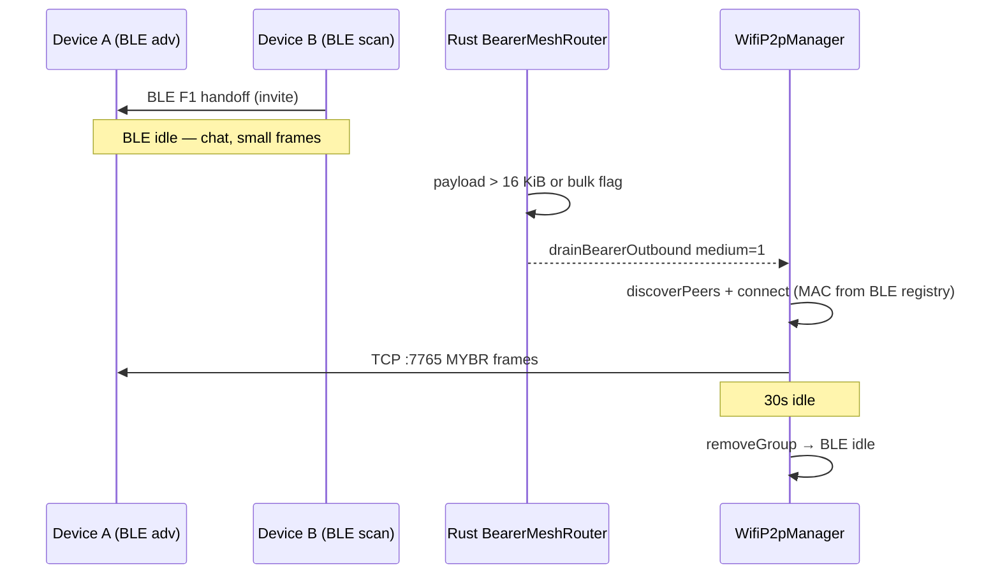

# ADR 007: Wi‑Fi Direct bulk bearer (Android) and iOS high-throughput path

**Status:** Accepted (Android Phase 1 shipped; iOS deferred)  
**Date:** 2026-07-04  
**Context:** BLE GATT delivers ~100–300 kbit/s effective at short range — adequate for invites, chat, and DTN custody, but insufficient for images, bulletin attachments, or mini-app bundles during ad-hoc mesh encounters. Prompt 13 introduced [`BearerTransport`](../../crates/mycelium-core/src/bearer_transport.rs) as a unified framing layer; this ADR adds a **second physical bearer** with an automatic **BLE → bulk → BLE idle** upgrade path.

Related: [ADR 002](./002-ble-mesh-transport.md) · [BEARER_TRANSPORT.md](../BEARER_TRANSPORT.md)

---

## Decision

### Android (implemented)

1. **Discovery and idle stay on BLE** (F1 advertising/scan, low duty cycle).
2. **Payload routing in Rust** (`BearerMeshRouter`):
   - Frames ≥ **16 KiB** (configurable: `MYCELIUM_BEARER_WIFI_UPGRADE_BYTES`) → `BearerMedium::WifiDirect`.
   - Mini-app bundles and explicit bulk → `queue_bearer_bulk()` (always Wi‑Fi Direct).
   - Smaller chat/control frames → BLE (`medium=0`).
3. **Host upgrade:** `WifiDirectBearerHost` (`WifiP2pManager`) opens a P2P group when Rust drains `medium=1` frames; maps peer via existing `BleMeshLinkRegistry` (same device MAC from BLE handoff).
4. **Wire format:** Same MYBR/MYBL/MYLP bearer bytes as BLE; TCP length-prefix framing on port **7765** (no second protocol stack).
5. **Downgrade:** After **30 s** idle (`WifiDirectBearer.IDLE_DOWNGRADE_MS`), remove P2P group and return to BLE-only relay loops.

### iOS (not implemented — see analysis below)

Do **not** use deprecated **Multipeer Connectivity** for new work. Plan **Network framework** peer-to-peer (`NWParameters.includePeerToPeer = true`) as the iOS bulk bearer when the Swift shell ships, reusing the same Rust `BearerMedium::WifiDirect` tag and MYBR frames.

---

## Upgrade flow (Android)

---

## Apple Multipeer Connectivity vs Network framework

| Topic | Multipeer Connectivity (MPC) | Network framework P2P |
|-------|------------------------------|------------------------|
| **Status (2026)** | Effectively **deprecated**; Apple DTS recommends migration | **Actively maintained** (WWDC 2025 structured concurrency updates) |
| **Transport** | AWDL + infrastructure Wi‑Fi + legacy Bluetooth docs (stale) | Explicit opt-in `includePeerToPeer`; may use AWDL under the hood |
| **Reliability** | Regression reports on iOS 18+ / 26 for pairing; peer-ID collisions | More direct connection control; viability handlers |
| **Background** | Similar to BLE — **not** continuous background mesh | Same — foreground / brief background only |
| **App Store** | Allowed but declining API surface | Preferred for new P2P |
| **Mycelium fit** | **Poor** — proprietary session API, deprecation, pairing bugs | **Good** — TCP/QUIC-like streams, aligns with Android TCP bearer |

### Apple restrictions (both paths)

- **No public WifiP2pManager equivalent** on iOS — third-party apps cannot drive Android-style Wi‑Fi Direct group owner negotiation directly.
- **AWDL is an implementation detail**, not a stable API; Apple may change behavior per OS release.
- **Peer-to-peer Wi‑Fi degrades infrastructure Wi‑Fi latency** when enabled — must be **opt-in** in Settings (same as “Maximum connectivity”).
- **Background execution** remains limited: bulk transfer is a **foreground or BLE-wakeup** scenario, not silent overnight sync.
- **Bonjour / local network privacy** prompts apply when browsing peers (Network framework or MPC).

### Conclusion for iOS

| Verdict | Detail |
|---------|--------|
| **MPC as iOS equivalent?** | **Not recommended** — deprecated, unreliable on recent iOS, poor long-term bet. |
| **Practical iOS path?** | **Network framework** with `includePeerToPeer`, BLE for discovery/handoff (already in `ios/Mycelium/BLE/`), TCP MYBR on a negotiated port — mirror Android semantics behind `BearerMedium::WifiDirect`. |
| **Wi‑Fi Aware** | Emerging cross-platform standard; watch for future alignment, not Phase 1. |

---

## Rust / FFI surface

| API | Role |
|-----|------|
| `BearerMedium` | `Ble=0`, `WifiDirect=1` |
| `should_upgrade_to_wifi_direct(len, force_bulk)` | Routing policy |
| `drain_bearer_outbound` | Returns `(peer, frame, medium)` |
| `queue_bearer_bulk(peer, bytes)` | Force Wi‑Fi Direct (mini-app bundles) |
| `ingest_ble_frame` / future `ingest_bearer_frame` | Same decode path for inbound bulk |

---

## Android implementation map

| File | Role |
|------|------|
| `WifiDirectBearerHost.kt` | WifiP2pManager, TCP send |
| `WifiDirectRelay.kt` | Drain `medium=1`, send |
| `BleMeshRelay.kt` | Drain `medium=0` only |
| `MeshService.kt` | 2 s relay loop + idle downgrade |

---

## Consequences

### Positive

- Images, large bulletins, and mini-app bundles can transfer locally without internet.
- Single MYBR framing and `BearerTransport` trait across bearers.
- BLE battery profile preserved for idle/discovery.

### Negative / risks

- Wi‑Fi Direct UX varies by OEM; P2P group formation adds 2–12 s latency on upgrade.
- Location/Wi‑Fi permissions still required on Android for P2P discovery.
- iOS parity requires separate Network framework host — not interchangeable APK logic.
- Inbound Wi‑Fi Direct ingest on Android (TCP server → `ingest_ble_frame`) is Phase 1b.

---

## Phase 1b (follow-up)

- [ ] Android inbound TCP → `ingest_bearer_frame` reassembly
- [ ] iOS Network framework bearer host scaffold
- [ ] Capability bit in BLE invite (“supports wifi bulk”)
- [ ] Settings toggle: “Allow Wi‑Fi Direct bulk (uses more battery)”
