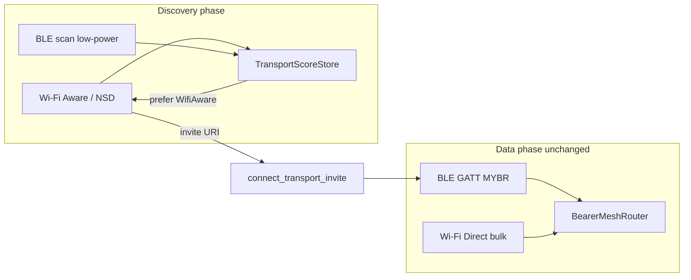

# ADR 009: Wi-Fi Aware as discovery-only bearer

**Status:** Accepted (Android Phase 1)  
**Date:** 2026-07-05  
**Context:** Continuous BLE LE scanning for F1 bootstrap discovery is reliable but costly on battery at comparable indoor range. Android **Wi-Fi Aware** (NAN) and **NSD** can advertise small service-specific payloads with lower average radio duty cycle. Mycelium already routes **data** via [`BearerMeshRouter`](../../crates/mycelium-node/src/bearer_mesh.rs) (BLE trickle + Wi-Fi Direct bulk, [ADR 007](./007-wifi-direct-bulk-bearer.md)). We need a third [`BearerMedium`](../../crates/mycelium-core/src/bearer_transport.rs) without duplicating bulk transfer paths.

Related: [ADR 002](./002-ble-mesh-transport.md) · [BEARER_TRANSPORT.md](../BEARER_TRANSPORT.md)

---

## Decision

1. **Introduce `BearerMedium::WifiAware` (discovery-only)** behind [`BearerTransport`](../../crates/mycelium-core/src/bearer_transport.rs) via [`BearerWifiAwareRouter`](../../crates/mycelium-node/src/bearer_wifi_aware.rs).
   - `carries_mesh_data() == false` — no MYBR/MYLP mesh payloads on this bearer.
   - Publishes **transport invite URIs only** (≤240 B), same semantic as BLE GATT invite read (F1).

2. **Separate discovery scoring from data-path scoring.**
   - [`decide_discovery_bearer`](../../crates/mycelium-core/src/transport_score.rs) chooses Wi-Fi Aware vs BLE for **presence**.
   - [`decide_transport_path`](../../crates/mycelium-core/src/transport_score.rs) is unchanged for **payload routing** (Internet → Wi-Fi Direct → BLE → custody).

3. **Android host (`WifiAwareDiscoveryHost.kt`):**
   - Primary: `WifiAwareManager` publish/subscribe on service name `mycelium-mesh`.
   - Fallback: `NsdManager` on `_mycelium._tcp` when Aware unavailable.
   - On peer sighting: `ingest_wifi_aware_discovery` + shared [`TransportInviteHandoff`](../../android/app/src/main/java/network/mycelium/app/bootstrap/TransportInviteHandoff.kt).
   - When Rust reports `prefer_wifi_aware_for_discovery()`, BLE scanner switches to `SCAN_MODE_LOW_POWER`.

4. **BLE remains the data bootstrap path** after discovery (GATT mesh data F2/F3, Wi-Fi Direct upgrade per ADR 007).

---

## Why Wi-Fi Aware is discovery-only (not bulk transfer)

| Factor | Wi-Fi Aware for discovery | Wi-Fi Aware as bulk bearer |
|--------|---------------------------|----------------------------|
| **Energy** | Low-duty NAN publish/subscribe fits small invite frames | NDP data paths + TCP-like sessions rival Wi-Fi Direct; duplicates ADR 007 |
| **Throughput** | Not required — invite is ~200 B | Wi-Fi Direct already handles 16 KiB+ MYBR with mature host code |
| **Complexity** | One code path: announce + ingest URI | Would need second bulk queue, thermal throttling, score merge, inbound TCP |
| **OEM variance** | Acceptable for ephemeral discovery | P2P/NDP formation latency already painful on Wi-Fi Direct alone |
| **Security model** | Signed invite v3 unchanged; no new trust root | Larger attack surface on unsolicited data channels |

**Conclusion:** Wi-Fi Aware optimizes **who we look for** (energy). BLE + Wi-Fi Direct optimize **what we send** (size/latency). Combining both roles would not reduce complexity or improve the existing bulk path.

---

## Architecture

---

## Rust / FFI surface

| API | Role |
|-----|------|
| `BearerMedium::WifiAware` | Host tag (not returned from `drain_bearer_outbound`) |
| `decide_discovery_bearer` / `prefer_wifi_aware_for_discovery` | Discovery policy |
| `set_wifi_aware_available` | Host capability |
| `queue_discovery_announcement` | Publish invite bytes |
| `ingest_wifi_aware_discovery` | Record peer + update scores |
| `record_ble_discovery_observation` | BLE scan cost feedback |

---

## Consequences

### Positive

- Lower average discovery energy when Aware is available; BLE scan duty reduced adaptively.
- Single invite handoff path for BLE GATT and Wi-Fi Aware.
- Data routing and thermal throttling (energy profile) stay unchanged.

### Negative / risks

- Wi-Fi Aware requires Android 8+ and hardware support; NSD fallback is LAN-scoped only.
- Location / nearby Wi-Fi permissions still apply on some OEMs.
- iOS has no WifiAwareManager equivalent — BLE discovery remains primary there ([ADR 001](./001-mobile-host-architecture.md)).

---

## Follow-up

- [ ] Capability bit in invite: `discovery=aware|ble`
- [ ] Metrics: discovery bearer mix in `NodeMetrics`
- [ ] iOS: Network framework browse for LAN NSD parity only
