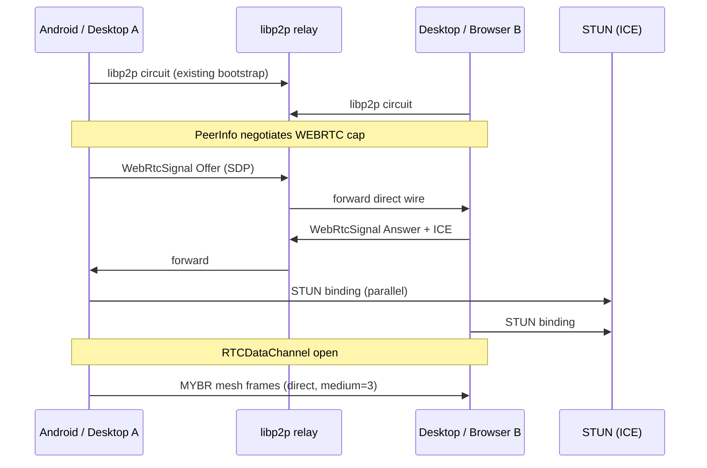

# ADR 010: WebRTC data-channel bearer (phone↔desktop/browser)

**Status:** Accepted  
**Date:** 2026-07-05  
**Context:** Mobile mesh clients use BLE and Wi‑Fi Direct for ad-hoc encounters. **Desktop** and **browser** clients (mycelium-desktop, web miniapp hosts) have no equivalent radio path and today rely entirely on **libp2p Internet relay** circuits. Relay adds latency and load; many NAT topologies allow **direct UDP/TCP** once peers know each other's addresses.

WebRTC provides ICE/STUN NAT traversal and an ordered **RTCDataChannel** without operating a dedicated signaling server.

Related: [BEARER_TRANSPORT.md](../BEARER_TRANSPORT.md) · [ADR 007](./007-wifi-direct-bulk-bearer.md)

---

## Decision

1. **New data bearer:** [`BearerMedium::WebRtc`](../../crates/mycelium-core/src/bearer_transport.rs) (`medium=3`) carries the same **MYBR** frames as BLE/Wi‑Fi Direct after the data channel opens.

2. **Signaling only over existing relay:** SDP offers/answers and ICE candidates are exchanged as [`WireMessage::WebRtcSignal`](../../crates/mycelium-core/src/transport.rs) on the established **libp2p direct** path (including relay circuits). No new HTTP signaling service.

3. **Path selection:** When an RTCDataChannel is ready toward a peer, [`decide_transport_path`](../../crates/mycelium-core/src/transport_score.rs) prefers **`TransportPath::WebRtc`** over **`InternetRelay`**. Until ICE completes, traffic stays on relay (including signaling).

4. **Capability flag:** [`ProtocolCapabilityFlags::WEBRTC`](../../crates/mycelium-core/src/protocol_capabilities.rs) is negotiated in `PeerInfo`. Initiator = lexicographically smaller libp2p PeerId.

5. **STUN defaults:** Public Google STUN (`stun.l.google.com:19302`) via [`default_stun_servers()`](../../crates/mycelium-core/src/webrtc_signaling.rs). No TURN in Phase 1 — relay remains fallback when ICE fails.

6. **Not a mobile↔mobile replacement:** Android may expose WebRTC for phone↔desktop, but **BLE / Wi‑Fi Direct remain** the primary phone↔phone bearers.

---

## Flow

---

## Host integration

| Platform | Host module | Notes |
|----------|-------------|-------|
| Desktop | `ui/src/lib/webrtcHost.ts` + Tauri commands | Browser WebRTC APIs in Tauri webview |
| Android | `WebRtcDiscoveryHost.kt` | `stream-webrtc-android` / org.webrtc |
| Web miniapp | Parent host (desktop) | iframe network blocked; bridge via host WebRTC loop |

---

## FFI surface

- `set_webrtc_available`, `set_webrtc_link_ready`
- `post_webrtc_signal`, `drain_webrtc_signaling_inbound`, `drain_webrtc_negotiation_requests`
- `ingest_webrtc_frame`, `drain_bearer_outbound` (`medium=3`)
- `webrtc_stun_servers()`

---

## Security

| Topic | Mitigation |
|-------|------------|
| Signaling integrity | Carried inside authenticated libp2p direct request/response |
| SDP injection | Only accepted from connected peers; session tied to negotiated WEBRTC cap |
| Data channel | MYBR decode + existing mesh signature / ingest guards unchanged |

---

## Deferred

- TURN server / corporate NAT fallbacks beyond relay
- iOS WebRTC host (Network.framework + WebRTC.framework)
- Metrics: `webrtc_links_active` in `NodeMetrics` ✅ (2026-07-05)
- Miniapp-in-iframe direct WebRTC (requires CSP / bridge extension)
